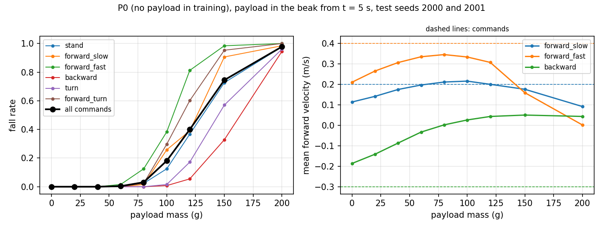
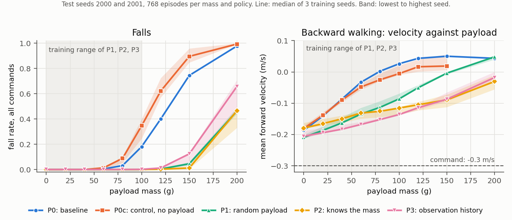
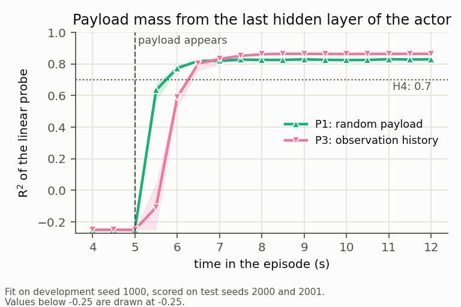
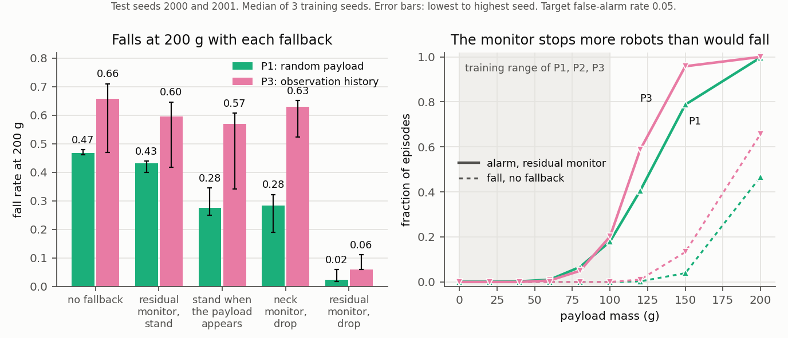

# Payload on a small biped: randomize, adapt or monitor?

A small biped (Microduck, about 0.25 m tall) walks with a reinforcement-learning policy.
It picks up an object of unknown mass with its beak. This project asks three questions:

1. At which payload mass does a standard walking policy fail, and how?
2. Which method keeps the robot walking best: domain randomization of the payload,
   privileged payload information, or adaptation from observation history?
3. Can a runtime monitor detect a payload that is too heavy, early enough to prevent the fall?

Short answers, from the tests below:

1. A policy trained without payload starts to fall at 80 g (11 % of the robot mass).
   Its velocity changes before it falls.
2. Domain randomization is enough to stop the falls inside the training range, and it
   has no cost without payload. Privileged information and history do not lower the
   tracking error. They do keep the velocity constant when the payload changes.
   Outside the training range, the history policy falls more often than the others.
3. A learned one-step model gives an alarm 0.7 to 0.9 s before the fall, for all falls
   at 200 g. A simple threshold on the neck joint is 0.3 s later and misses a quarter
   of the falls. To stand after the alarm does not help. To drop the payload does.

We wrote the hypotheses before each test. Of 17 hypotheses, 14 hold, 2 fail, and
1 could not be tested as written. The sections below give each result.

- Report (6 pages): [report/main.pdf](report/main.pdf)
- Video (40 s): [results/video/demo.mp4](results/video/demo.mp4). It shows one typical
  episode for each condition, side by side. The numbers in its text come from the tests.

This work is in simulation only. It uses the
[microduck_rl](https://github.com/pollen-robotics/microduck_rl) task from Pollen Robotics
(MuJoCo Warp through mjlab, PPO from rsl_rl). The upstream code is not part of this
repository. We use it at a fixed commit and do not change it.

## Status

| Stage | Content | Status |
|---|---|---|
| D0 | Environment setup and speed test on one laptop GPU (RTX 5060, 8 GB) | Done |
| D1 | Baseline policy P0 (upstream task, no payload) and evaluation protocol | Done |
| D2 | Payload in the beak and the failure curve of P0 | Done |
| D3 | Payload randomization, privileged information, history adaptation | Done |
| D4 | Runtime monitors with conformal thresholds, and fallbacks | Done |

## Baseline result (P0, no payload)

P0 trains for 3000 iterations with 4096 parallel environments (2.4 h). The evaluation
removes the curriculum and the random pushes, and gives each robot one fixed velocity
command for a 20 s episode. 128 robots per command, development seed 1000.

| Command | Value | Fall rate | Mean measured velocity |
|---|---|---|---|
| stand | 0 | 0 | 0.00 m/s |
| forward_slow | vx 0.2 m/s | 0 | 0.11 m/s |
| forward_fast | vx 0.4 m/s | 0 | 0.22 m/s |
| backward | vx -0.3 m/s | 0 | -0.18 m/s |
| sideways | vy 0.2 m/s | 0 | 0.01 m/s |
| turn | wz 0.8 rad/s | 0 | 0.65 rad/s |

P0 does not fall in 896 episodes. But it walks at only 50-60 % of the commanded forward
speed, and it does not walk sideways. We checked the measurement against the distance
that the robots walked. This is the behavior of the policy, not an error in the
evaluation. The payload experiments will therefore compare each policy with its own
result without payload.

Video (one robot per command, caption shows command and measured velocity):
[results/video/p0_seed0_dev1000.mp4](results/video/p0_seed0_dev1000.mp4)

## Payload setting

The robot holds a thin rod in its beak. The payload is a ball at the end of the rod,
78 mm in front of the tip of the beak. The rod has no mass. The payload appears 5 s after
the start of the episode, as if the robot picks it up. The masses are 0 to 200 g (the robot
is 0.737 kg). The hypotheses and the frozen test settings are in
[prereg/D2_hypotheses.md](prereg/D2_hypotheses.md). They are committed before the test runs.
The first version of that file said that the payload is at the tip of the beak. This was
an error in the description. The file has a dated correction. The results did not change.

## Result: failure curve of P0 (test seeds)

P0 never saw a payload in training. Test seeds 2000 and 2001, 768 episodes per mass
(128 per command).



| Mass (g) | 0 | 20 | 40 | 60 | 80 | 100 | 120 | 150 | 200 |
|---|---|---|---|---|---|---|---|---|---|
| Fall rate, all commands | 0 | 0 | 0 | 0.004 | 0.031 | 0.181 | 0.400 | 0.745 | 0.978 |
| forward_fast vx (m/s), command 0.4 | 0.21 | 0.27 | 0.31 | 0.34 | 0.35 | 0.33 | 0.31 | 0.16 | 0.00 |
| backward vx (m/s), command -0.3 | -0.19 | -0.14 | -0.09 | -0.03 | 0.00 | 0.03 | 0.04 | 0.05 | 0.04 |

All four parts of hypothesis H1 hold:

| Hypothesis | Result |
|---|---|
| H1a. Fall rate at most 0.02 up to 60 g | Holds: 0, 0, 0, 0.004 |
| H1b. Fall rate crosses 0.5 between 120 g and 150 g | Holds: 0.400 and 0.745 |
| H1c. At 60 g, backward speed is less than half of its value at 0 g, with few falls | Holds: 0.03 m/s against 0.19 m/s, fall rate 0.004 |
| H1d. At 100 g and 120 g, forward_fast falls most and backward falls least | Holds: 0.38 and 0.01 at 100 g, 0.81 and 0.05 at 120 g |

The failure has two stages. Up to 60 g the robot does not fall, but its velocity moves
forward: it walks forward faster and it almost cannot walk backward. From 80 g it starts
to fall. The payload also pushes the head down, because the neck servos are soft. This
moves the payload farther forward. H1 used the same policy as the development result,
so it is a check on new seeds, not a strong test.

Videos of P0 with a payload, all six commands (development seed):
[60 g](results/video/p0_seed0_mouth_60g_dev1000.mp4),
[100 g](results/video/p0_seed0_mouth_100g_dev1000.mp4).
Their text says "in the beak". The payload is at the end of the rod, as in the section above.

## Result: three methods against the payload (test seeds)

All methods start from the P0 checkpoint and train for 1000 more iterations
(about 53 min each). Each method has 3 training seeds.

| Policy | Training payload | What the actor sees |
|---|---|---|
| P0c (control) | none | the upstream observation (61 values) |
| P1 | random, 0 to 100 g | the same |
| P2 | random, 0 to 100 g | the same, and the true payload mass |
| P3 | random, 0 to 100 g | the last 25 observations (0.5 s). Only the critic sees the mass |



In the right panel, the line of P0c stops at 150 g. At 200 g all its robots fall before
the measurement starts.

Test seeds 2000 and 2001, 768 episodes per mass and policy. Median of 3 training seeds.

| | P0c | P1 | P2 | P3 |
|---|---|---|---|---|
| Fall rate at 100 g | 0.346 | 0 | 0 | 0.001 |
| Fall rate at 150 g | 0.896 | 0.046 | 0.012 | 0.124 |
| Fall rate at 200 g | 0.993 | 0.462 | 0.465 | 0.658 |
| Tracking RMSE at 0 g (m/s) | 0.180 | 0.180 | 0.181 | 0.180 |
| Tracking RMSE, mean of 20 to 100 g (m/s) | 0.193 | 0.161 | 0.163 | 0.158 |
| Change of backward velocity, 0 to 100 g (m/s) | 0.175 | 0.127 | 0.051 | 0.067 |
| Change of forward_fast velocity, 0 to 100 g (m/s) | 0.172 | 0.108 | 0.019 | 0.047 |

| Hypothesis | Result |
|---|---|
| H2a. P1 has a fall rate of at most 0.05 for each mass up to 100 g | Holds: the highest value is 0 |
| H2b. Without payload, the tracking RMSE of P1 is at least 5 % higher than that of P0c | Fails: 0.1796 against 0.1805, a ratio of 0.995 |
| H3a. From 20 to 100 g, P3 closes at least half of the gap in tracking RMSE between P1 and P2 | Not supported: P2 is not better than P1, so there is no gap |
| H3b. At 150 g, P3 has a lower fall rate than P1 | Fails: 0.124 against 0.046 |
| H4. A linear model reads the payload mass from the last hidden layer of the P3 actor, R^2 above 0.7 | Holds: 0.861 |

What we learned:

- Randomization of the payload removes the falls inside the training range. More
  training without payload does not (P0c). We expected a cost without payload. There is none.
- We expected that the true mass (P2) lowers the tracking error. It does not. The reason
  is the baseline: without payload, all policies walk forward at about half of the
  commanded speed. The payload pushes P1 forward, and this hides its error.
- The last two rows of the table show a clear order: the velocity changes least with
  the payload for P2, then P3, then P1. Each seed of P2 and P3 is below each seed of
  P1. We did not preregister this measure. It is an exploratory result.
- P3 adapts inside the training range but falls more often outside it (2 of 3 seeds).

## Result: the payload mass in the hidden layer (test seeds)

A linear model reads the payload mass from the 128 values of the last hidden layer of
the actor. We fit it on development seed 1000 and score it on the test seeds.
The settings are in [prereg/D3_probe_settings.md](prereg/D3_probe_settings.md).



| | R^2, training seeds 0, 1, 2 | Median |
|---|---|---|
| P3 | 0.861, 0.869, 0.859 | 0.861 |
| P1 (comparison) | 0.826, 0.836, 0.829 | 0.829 |

H4 holds. But P1 has no history and no mass input, and its result is almost the same.
The mass is thus in the current observation: the payload pushes the soft neck down.
The probe shows that the information is there. It does not show that the policy uses it.
P1 has the information, but its velocity still changes with the payload.

## Result: runtime monitors and fallbacks (test seeds)

For P1 and P3, an episode is normal when the payload is inside the training range
(0 to 100 g). A monitor must be silent there, and it must give an alarm for a heavier
payload. Each monitor compares one signal with a threshold. The threshold comes from
normal episodes of a development seed (split conformal, target false-alarm rate 0.05).
The hypotheses and settings are in [prereg/D4_hypotheses.md](prereg/D4_hypotheses.md).
The thresholds and models are in `results/d4/frozen/`.

| Signal | Content | On a real robot |
|---|---|---|
| neck | position error of the neck joint (the simple baseline) | yes |
| residual | error of a learned one-step model of the robot | yes |
| value | output of the critic | no: the critic reads simulator state |
| probe | payload mass from the linear probe | yes |

At 200 g, test seeds 2000 and 2001, median of 3 training seeds (P1 / P3):

| | neck | residual | value | probe |
|---|---|---|---|---|
| False-alarm rate, normal episodes | 0.052 / 0.050 | 0.045 / 0.045 | 0.050 / 0.049 | 0.057 / 0.054 |
| Falls with an alarm before the fall | 0.74 / 0.74 | 1.00 / 1.00 | 1.00 / 1.00 | 1.00 / 0.95 |
| Time from the alarm to the fall (s) | 0.58 / 0.70 | 0.74 / 0.90 | 0.80 / 1.18 | 0.66 / 0.82 |
| Time from the payload to the alarm (s) | 0.62 / 0.68 | 0.32 / 0.30 | 0.20 / 0.02 | 0.34 / 0.30 |

The critic of P3 sees the true payload mass. Its alarm after 0.02 s is not a detection.

Two fallbacks act at the alarm. Stand: the velocity command goes to zero. Drop: the
robot lets go of the payload, with no delay (the best case).



| Fall rate | No fallback | Residual, stand | Stand when the payload appears | Neck, drop | Residual, drop |
|---|---|---|---|---|---|
| P1, 150 g | 0.039 | 0.042 | 0.012 | 0.038 | 0.004 |
| P1, 200 g | 0.467 | 0.432 | 0.276 | 0.283 | 0.023 |
| P3, 150 g | 0.133 | 0.102 | 0.053 | 0.255 | 0.060 |
| P3, 200 g | 0.658 | 0.596 | 0.570 | 0.629 | 0.059 |

| Hypothesis | Result (P1 / P3) |
|---|---|
| H5a. The false-alarm rate of each monitor is at most 0.08 | Holds: highest 0.057 / 0.054 |
| H5b. Residual at 200 g: at least 0.95 of the falls have an alarm, more than 0.3 s before the fall | Holds: 1.00, 0.74 s / 1.00, 0.90 s |
| H5c. Neck at 200 g: lower than residual by at least 0.10 | Holds: 0.74 against 1.00 / 0.74 against 1.00 |
| H5d. Residual with stand at 200 g: the fall rate stays above half of the rate without fallback | Holds: 0.432 against 0.467 / 0.596 against 0.658 |
| H5e. Residual with drop at 200 g: the fall rate is at most a quarter of the rate without fallback | Holds: 0.023 against 0.467 / 0.059 against 0.658 |
| H5f. P3 at 150 g: neck with drop has a higher fall rate than no fallback | Holds: 0.255 against 0.133 |
| H6a. P1 at 200 g: value gives the alarm earlier than residual | Holds: 0.20 s against 0.32 s |
| H6b. P3 at 200 g: probe catches fewer falls than residual | Holds: 0.95 against 1.00 |

How to read these results:

- All eight hypotheses hold. We wrote them from development results of the same
  policies. The tests show that the results repeat on new evaluation seeds. They are
  not as strong as the tests of H2 and H3, which we wrote before we saw any result.
- The first plan said that stand after the alarm halves the falls. On the development
  seed this was false, also when the robot stands from the moment the payload appears.
  We then added drop. H5d states the result for stand as we expected it at that time.
- The alarm must be early. With the same fallback (drop), the neck monitor is 0.3 s
  later than the residual monitor, and the fall rate of P1 at 200 g is 0.283, not 0.023.
  For P3, a late drop is worse than no fallback.
- The monitor has a cost. It detects "outside the training range", not "about to fall".
  At 100 g, it stops about 0.19 of the robots, and almost none of them would fall. At
  150 g, it stops 0.79 (P1) and 0.96 (P3) of the robots, and 0.04 and 0.13 would fall.
- An accumulation of the signal (CUSUM) did not help here. The change is sudden and large.

## Limits

- Simulation only. There is no test on the real robot.
- One kind of fault: a payload that is too heavy and appears suddenly.
- One robot, one task, and 3 training seeds for each method.
- The evaluation is not exactly repeatable. Differences of fall rates below about
  0.03 have no meaning.
- The drop fallback has no delay and no model of the release.

## How to run

The training runs in WSL2 (Ubuntu 24.04) with the locked environment of the upstream
repository. Clone upstream into `third_party/microduck_rl`, check out commit `bae39f5`,
and run `uv sync --locked` there. Then run all commands from the upstream folder.
`$R` is the path of this repository.

```bash
# D1, D2: baseline, evaluation, failure curve, video, tests
bash $R/scripts/train_p0.sh 4096 3000 0
uv run --locked python $R/scripts/evaluate.py --checkpoint <run>/model_2999.pt --seed 1000 --payload-mass-g 0 60 100 --out <folder>
uv run --locked python $R/scripts/failure_curve.py --runs <folder> [<folder> ...] --out <path>
uv run --locked python $R/scripts/record_video.py --checkpoint <run>/model_2999.pt --payload-mass-g 100 --out <file>.mp4
uv run --locked --with pytest pytest -q $R/tests

# D3: one method and one training seed, then the tests of H2 and H3
bash $R/scripts/finetune.sh PayloadDuck-P3 0 1000 4096
uv run --locked python $R/scripts/evaluate.py --task PayloadDuck-P3 --checkpoint <run>/model_3998.pt --seed 2000 --envs-per-command 64 --payload-mass-g 0 20 40 60 80 100 120 150 200 --out <folder>
uv run --locked python $R/scripts/judge_d3.py

# H4: record the hidden layer, then fit and score the probe
uv run --locked python $R/scripts/probe_collect.py --task PayloadDuck-P3 --checkpoint <run>/model_3998.pt --seed 1000 --payload-mass-g 0 20 40 60 80 100 120 150 200 --out <file>.npz
uv run --locked python $R/scripts/probe_fit.py --fit <seed 1000>.npz --score <seed 2000>.npz <seed 2001>.npz

# D4: record the signals, train the one-step model, score the monitors, test a fallback
uv run --locked python $R/scripts/monitor_collect.py --task PayloadDuck-P3 --checkpoint <run>/model_3998.pt --seed 1000 --payload-mass-g 0 20 40 60 80 100 120 150 200 --probe <weights>.npy --out <file>.npz
uv run --locked python $R/scripts/dynamics_train.py --data <seed 1000>.npz --out <model>.pt
uv run --locked python $R/scripts/monitor_eval.py --fit <seed 1000>.npz --cal <seed 1001>.npz --eval <seed 2000>.npz <seed 2001>.npz --dynamics <model>.pt --out <file>.json
uv run --locked python $R/scripts/fallback_eval.py --task PayloadDuck-P3 --checkpoint <run>/model_3998.pt --seed 2000 --envs-per-command 64 --payload-mass-g 0 20 40 60 80 100 120 150 200 --monitors <file>.json --dynamics <model>.pt --mode residual --fallback drop --out <file>.json
uv run --locked python $R/scripts/judge_d4.py --offline $R/results/d4/monitors_test --fallback $R/results/d4/fallback_test

# Figures, from the result files in this repository
uv run --locked python $R/scripts/make_figures.py

# Video: one clip for each condition, then put them together
uv run --locked python $R/scripts/record_clip.py --checkpoint <run>/model_3998.pt --command forward_fast --payload-mass-g 200 --monitors <file>.json --dynamics <model>.pt --mode residual --fallback drop --expect walk --out <folder>/s3_p1_drop
uv run --locked python $R/scripts/make_demo.py --clips <folder>
```

For P1 and P0c, do not give `--task` to the evaluation scripts. Their observation is
the upstream one. On one laptop GPU (RTX 5060, 8 GB), a training run of D3 takes about
53 min and one evaluation takes about 100 s.

## Layout

| Path | Content |
|---|---|
| `src/payload_duck/` | Payload body, training and evaluation environments, metrics, checkpoint expansion, monitors, one-step model |
| `scripts/` | Training, evaluation, probe, monitors, fallback, hypothesis tests, figures, video |
| `tests/` | Unit tests (33) for the payload, the environments, the metrics, the checkpoint expansion and the monitors |
| `prereg/` | Hypotheses and frozen settings, committed before the test runs |
| `results/eval/` | Evaluation of each policy on the development seed and the test seeds |
| `results/d2/`, `results/d3/`, `results/d4/` | Tables, figures and frozen monitor settings of each stage |
| `results/video/` | Videos of the baseline policy |
